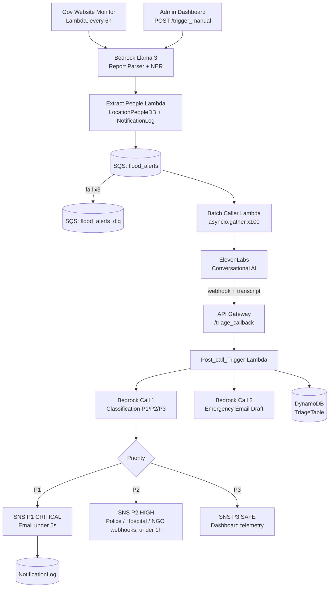

# 🌊 Project Sentinel

**Closing the feedback loop in flood response: from government bulletin to rescue dispatch in seconds.**

> WeMakeDevs Hackathon 2026 · Track 2: Heat & Water · AWS Region `ap-south-1` (Mumbai)


https://github.com/user-attachments/assets/f82f666e-88f9-4e26-8c99-4adc71800f6b


---

## Table of Contents

1. [Overview](#1-overview)
2. [The Problem](#2-the-problem)
3. [Key Features](#3-key-features)
4. [Live Demo](#4-live-demo)
5. [Public Dashboard](#5-public-dashboard)
6. [System Architecture](#6-system-architecture)
7. [Module Breakdown](#7-module-breakdown)
8. [Triage Logic and Escalation Matrix](#8-triage-logic-and-escalation-matrix)
9. [Data Models](#9-data-models)
10. [API Reference](#10-api-reference)
11. [Configuration and Benchmarks](#11-configuration-and-benchmarks)
12. [Quickstart: Run the Demo](#12-quickstart-run-the-demo)
13. [Security and Privacy](#13-security-and-privacy)
14. [Known Limitations and Roadmap](#14-known-limitations-and-roadmap)
15. [Tech Stack](#15-tech-stack)

---

## 1. Overview

Project Awaaz is a serverless, AI-driven flood-response pipeline. It:

1. **Detects** flood warnings by monitoring official government bulletins (or a manual officer trigger).
2. **Identifies** the at-risk locations and the households registered there.
3. **Calls** up to **100 residents in parallel** with a vernacular voice alert (ElevenLabs Conversational AI).
4. **Triages** each spoken response with Amazon Bedrock (Meta Llama 3 8B) into P1 / P2 / P3.
5. **Escalates** life-threatening cases to emergency responders in **under 5 seconds**.

## 2. The Problem

Flood alerts in India are typically one-way broadcast SMS messages. These fail in regions with low functional literacy and give rescue teams **no ground-level intelligence**.

First responders such as the NDRF arrive blind. They cannot tell which households have already evacuated and which families are stranded on rooftops and need boat extraction.

**Awaaz makes the alert two-way.** Residents are called in their own language, they describe their situation by voice, and that information is structured and routed to the right responder.

## 3. Key Features

| Feature | Description |
|---|---|
| Automated detection | Scheduled Lambda scrapes government disaster bulletins every 6 hours. |
| Manual trigger | Officers can launch ward or pincode-level alerts from the admin dashboard. |
| AI report parsing | Bedrock classifies bulletins; only `is_warning == true` and `confidence > 0.8` proceed. |
| Location extraction | Bedrock NER outputs `location_name`, `lat`, `lng`, `threat_level`. |
| Massive parallel outreach | 100 concurrent outbound calls started within 8–10 s via `asyncio.gather`. |
| Vernacular voice IVR | ElevenLabs Conversational AI handles the call and captures the spoken reply. |
| Structured triage | Two-step Bedrock pipeline: classification, then emergency email drafting. |
| Tiered escalation | SNS topics for P1 (immediate), P2 (within 1 h), P3 (telemetry only). |
| De-duplication | `NotificationLog` prevents repeat calls across overlapping monitor cycles. |
| Live dashboard | Real-time P1/P2/P3 counts and per-area critical breakdown. |

## 4. Live Demo

| Resource | Value |
|---|---|
| Admin Dashboard | https://d1dqcfbos77hw1.cloudfront.net |
| REST API Base URL | `https://xkrq8kgs43.execute-api.ap-south-1.amazonaws.com/prod` |
| Demo username | `judge` |
| Demo password | `Awaaz@2026` |

> ⚠️ These are **demo-only credentials** for hackathon judging. They will be rotated or disabled after evaluation. See [Security and Privacy](#13-security-and-privacy).

## 5. Public Dashboard

A read-only, public-facing view of Awaaz's live flood-response status, hosted on AWS Amplify. No login is required.

| Resource | Value |
|---|---|
| Public Dashboard | https://main.d1h3rqw15o7lcd.amplifyapp.com/ |

Unlike the [admin dashboard](#4-live-demo), which officers use to trigger alerts, the public dashboard is for citizens, journalists and partner organisations who need situational awareness.

---

## 6. System Architecture

### 6.1 High-level flow



### 6.2 ASCII reference

```
[Gov Website Monitor / Admin Dash] ──> [Bedrock Llama 3 Parser] ──> [Extract People]
                                                                            │
┌─────────────────────────── [SQS "flood_alerts"] <─────────────────────────┘
│
├──> [Batch Caller Lambda] ──> [ElevenLabs Outbound Engine] (100 parallel calls)
│                                         │
│                                         ▼ (voice webhook)
└──> [Dead Letter Queue]        [API Gateway: /triage_callback]
                                          │
                                          ▼
                               [Post_call_Trigger Lambda]
                                          │
                     ┌────────────────────┴────────────────────┐
                     ▼                                         ▼
            [Bedrock Call 1]                          [Bedrock Call 2]
         (P1 / P2 / P3 triage)                    (Emergency Email Draft)
                     │                                         │
                     ▼                                         ▼
          ┌──────────┴──────────┐                          [Amazon SNS]
          ▼                     ▼                              │
    [P1_CRITICAL]          [P2_HIGH / P3_SAFE]                 ├──> [SNS P1 CRITICAL] ──> Responders (<5s)
          │                     │                              ├──> [SNS P2 HIGH]     ──> Police / Hospital Webhooks (<1h)
          └──────────┬──────────┘                              ├──> [SNS P3 SAFE]     ──> Dashboard Telemetry
                     │                                         │
                     ▼                                         └──> [DynamoDB: TriageTable, LocationPeopleDB, NotificationLog]
```

## 7. Module Breakdown

### Section A: Detection and Report Parsing

| Component | Responsibility |
|---|---|
| **Admin Dashboard (manual trigger)** | Lets disaster officers start ward-level alerts via `POST /api/v1/trigger_manual`. |
| **Gov Website Monitor** (Lambda) | Runs every 6 hours, or on manual invoke, to scrape official bulletins and warning portals. |
| **Report Parser** (Bedrock, `meta.llama3-8b`) | Evaluates each report for flood hazard. Proceeds only if `is_warning == true` **and** `confidence > 0.8`. Normal notices are skipped and logged. |
| **Location Extraction** (Bedrock NER) | Extracts named locations with coordinates and severity: `location_name, lat, lng, threat_level`. |
| **Extract People** (Lambda) | Reads `LocationPeopleDB` in batches of up to 100 residents and filters against `NotificationLog` to avoid duplicate dialing. |

### Section B: Queueing and Parallel Orchestration

**SQS Standard Queue `flood_alerts`**

| Setting | Value |
|---|---|
| Visibility timeout | 60 s |
| Message retention | 1 day |
| Batch size | 100 |
| Concurrency | 10 |
| DLQ | `flood_alerts_dlq` after 3 attempts, with exponential backoff |

**Message payload**

```json
{
  "phone": "+918650040322",
  "number_name": "Resident Name",
  "threat_id": "THREAT_...",
  "warning_id": "WARN_20261011_01",
  "message_attempt": 1
}
```

**Batch Caller Lambda** fetches provider credentials from **AWS Secrets Manager** and uses `asyncio.gather` to place 100 parallel outbound calls within 8–10 s.

**ElevenLabs Outbound Engine** starts conversational voice sessions. Each session uses the conversation identifier `{warning_id}_{phone_number}`.

### Section C: Voice Intake and AI Triage

1. **ElevenLabs Conversational AI** delivers a vernacular warning (for example, *"Emergency alert: flooding…"*) and records the resident's spoken response.
2. **API Gateway** `POST /api/v1/triage_callback` (API-key authenticated) receives transcripts and metadata when the call completes.
3. **Post_call_Trigger Lambda** then:
   1. Ingests the callback payload.
   2. Fetches the full audio transcript.
   3. Parses, cleans and validates conversation parameters.
   4. Runs **Bedrock Call 1** (priority classification).
   5. Runs **Bedrock Call 2** (formal dispatch email).
   6. Publishes to the matching **SNS** topic.
   7. Persists everything to **DynamoDB**.

### Section D: Bedrock Pipeline and Notification Matrix

**Bedrock Call 1: Classification output**

```json
{
  "priority": "P1_CRITICAL | P2_HIGH | P3_SAFE",
  "one_line_needs": ["Boat extraction", "Drinking water"],
  "people_count": 5,
  "location_root": "Rooftop",
  "water_level": "Rising fast",
  "risk": "High",
  "emergency": true,
  "tags": ["trapped", "elderly"]
}
```

**Bedrock Call 2: Email draft**

- Subject: `[P1_CRITICAL] Flood Alert - {phone}`
- Body: professional NDRF-style incident notification.
- Recipient: read from **SSM Parameter Store** (not hard-coded).

## 8. Triage Logic and Escalation Matrix

| Priority | Meaning | Channel | Target latency | Recipient |
|---|---|---|---|---|
| **P1_CRITICAL** | Life-threatening (trapped, rising water, needs rescue) | SNS → email | **< 5 s** | Emergency response / NDRF |
| **P2_HIGH** | Urgent but not immediately life-threatening | SNS → webhooks | **< 1 h** | Hospital, police dispatch, NGO integrations |
| **P3_SAFE** | Resident confirms safety | SNS → dashboard | n/a | Operations dashboard telemetry only |

## 9. Data Models

All tables run in **on-demand** capacity mode.

### 9.1 `TriageTable`: case history and post-call state

| Property | Detail |
|---|---|
| PK | `conversation_id` (String) |
| SK | `created_at` (ISO timestamp, String) |
| GSIs | `phone_index`, `warning_index` |
| TTL | 90 days |
| Core attributes | `conversation_id`, `warning_id`, `phone`, `priority`, `needs[]`, `location_text`, `alert_sent_timestamp` |

### 9.2 `LocationPeopleDB`: household registry and vulnerability

| Property | Detail |
|---|---|
| PK | `location_id` (String) |
| SK | `phone_number` (String, E.164) |
| GSI | `area_id_index` |
| Core attributes | `location_id`, `name`, `vulnerability_score` (0–10), `area_lat`, `area_lng` |
| Scale | 10,000+ registered residents (estimated) |

### 9.3 `NotificationLog`: de-duplication and in-flight tracking

| Property | Detail |
|---|---|
| PK | `phone_number` (String, E.164) |
| SK | `warning_id` (String) |
| TTL | 7 days |
| Core attributes | `phone_number`, `warning_id`, `sqs_message_id`, `call_status` |

## 10. API Reference

**Base URL:** `https://xkrq8kgs43.execute-api.ap-south-1.amazonaws.com/prod`

### 10.1 `POST /api/v1/trigger_manual`: manual dispatch

Starts an outreach cycle for a district and pincodes.

**Request**

```json
{
  "district": "Bihar-Khagaria",
  "pincodes": ["841301"],
  "alert_type": "FLOOD",
  "officer_id": "OFFICER_001"
}
```

**Response `200 OK`**

```json
{
  "success": true,
  "queued": 100,
  "warning_id": "WARN_20261011_01"
}
```

### 10.2 `POST /api/v1/triage_callback`: ElevenLabs webhook

Called by the voice platform when a call completes.

**Headers**

```
x-api-key: <API_KEY>
Content-Type: application/json
```

**Request**

```json
{
  "conversation_id": "conv_5801m4n4y191fwtskb",
  "warning_id": "WARN_20261011_01",
  "phone": "+918650040322",
  "transcript": "Namaskar, hum chhat par phase hain, paani tezi se badh raha hai...",
  "status": "processing"
}
```

### 10.3 `GET /api/v1/stats`: live dashboard poll

**Response `200 OK`**

```json
{
  "p1_critical": 8,
  "p2_high": 24,
  "p3_safe": 68,
  "total": 100,
  "by_area": [
    { "location_name": "Mansi", "critical_count": 5 },
    { "location_name": "Chautham", "critical_count": 3 }
  ]
}
```

### 10.4 Example `curl` calls

```bash
# Trigger a manual alert
curl -X POST "$API_BASE/api/v1/trigger_manual" \
  -H "Content-Type: application/json" \
  -d '{"district":"Bihar-Khagaria","pincodes":["841301"],"alert_type":"FLOOD","officer_id":"OFFICER_001"}'

# Poll live stats
curl "$API_BASE/api/v1/stats"
```

## 11. Configuration and Benchmarks

| Parameter | Value |
|---|---|
| AWS region | `ap-south-1` (Mumbai) |
| LLM | `meta.llama3-8b-instruct-v1:0` via Amazon Bedrock (chosen for low cost and latency) |
| Parallel capacity | Up to 100 concurrent outbound calls started in 8–10 s |
| Standard Lambda timeout | 60 s |
| Batch Caller Lambda timeout | 300 s |
| P1 notification SLA | Generated and delivered in < 5 s |
| Monitor schedule | Every 6 hours (plus manual trigger) |

**Secrets and configuration**

| Item | Stored in |
|---|---|
| ElevenLabs credentials | AWS Secrets Manager |
| Emergency email recipient | SSM Parameter Store |
| Webhook API key | API Gateway API key |

## 12. Quickstart: Run the Demo

1. **Open the console.** Go to https://d1dqcfbos77hw1.cloudfront.net and sign in with the demo credentials from [Live Demo](#4-live-demo).
2. **Trigger an outreach cycle.** Select district **Bihar-Khagaria**, pincode **841301**, then submit the manual trigger.
3. **Take the call.** Answer the live call from the voice system, give situational feedback (for example, *"Hum chhat par hain"*), and hang up.
4. **Inspect triage results.** Watch the CloudWatch logs and the dashboard as the call is classified into the `p1_critical` ledger and the emergency email is sent.

**Expected outcome:** the dashboard's `p1_critical` count increments, and a `[P1_CRITICAL] Flood Alert - <phone>` email reaches the configured responder inbox.

## 13. Security and Privacy

- **Credentials:** The demo login is for judging only. Rotate or disable it after evaluation and avoid committing real credentials to a public repository.
- **Secrets:** Provider keys live in Secrets Manager and recipient addresses in Parameter Store, so neither is hard-coded in Lambda code.
- **Webhook auth:** `/triage_callback` requires an `x-api-key` header.
- **PII handling:** Phone numbers (E.164) and voice transcripts are personal data. `TriageTable` expires records after 90 days and `NotificationLog` after 7 days.
- **Least privilege:** Each Lambda should have a scoped IAM role (specific tables, topics, secrets, and Bedrock model ARN only).
- **Call consent and regulation:** Outbound automated calls should comply with applicable Indian telecom and data-protection rules (such as TRAI and DPDP Act obligations). Registries should only contain consented or officially sanctioned contacts.

## 14. Known Limitations and Roadmap

**Considerations for production hardening**

- **SQS visibility timeout vs. Lambda timeout:** the queue visibility timeout (60 s) is shorter than the Batch Caller timeout (300 s). AWS recommends a visibility timeout at least equal to the function timeout (commonly 6×), otherwise in-flight batches can be redelivered and callers dialed twice. Raise the visibility timeout accordingly, and keep the `NotificationLog` conditional write as the final de-duplication guard.
- **SQS batch size 100:** standard SQS event sources default to a maximum batch size of 10 unless a batching window is configured. Confirm the effective batch size in your deployment.
- **LLM accuracy:** Llama 3 8B is cost-efficient, but safety-critical triage should add rule-based keyword overrides (for example, "chhat", "doob", "bachao") and a human-review path.
- **Payload field naming:** `number_name` in the SQS payload may be intended as `phone_name` or `resident_name`. Standardise the schema.
- **Single recipient for P1:** use multiple subscribers, SMS or pager fallbacks to avoid a single point of failure.

**Roadmap ideas**

- [ ] Multilingual expansion (Bhojpuri, Maithili, Bengali, Assamese and others)
- [ ] Geospatial map of P1 clusters for rescue routing
- [ ] Call-retry and no-answer handling with escalation to SMS
- [ ] Integration with NDMA / State Disaster Management APIs
- [ ] Human-in-the-loop review console for low-confidence classifications
- [ ] Infrastructure-as-code (CDK / Terraform) for one-command deployment

## 15. Tech Stack

| Layer | Technology |
|---|---|
| Compute | AWS Lambda (Python, `asyncio`) |
| Messaging | Amazon SQS (+ DLQ), Amazon SNS |
| AI / LLM | Amazon Bedrock: `meta.llama3-8b-instruct-v1:0` |
| Voice | ElevenLabs Conversational AI |
| API | Amazon API Gateway (REST) |
| Storage | Amazon DynamoDB (on-demand) |
| Secrets / Config | AWS Secrets Manager, SSM Parameter Store |
| Frontend | Admin dashboard served via Amazon CloudFront |
| Observability | Amazon CloudWatch |

---

<p align="center"><b>Project Awaaz</b>: making every flood alert a conversation, and every conversation a rescue signal.</p>
